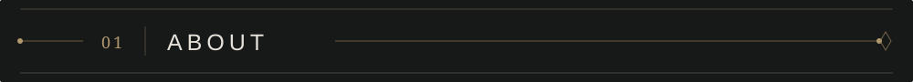
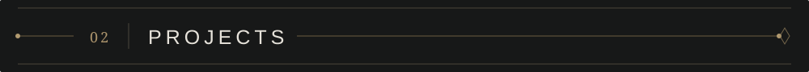
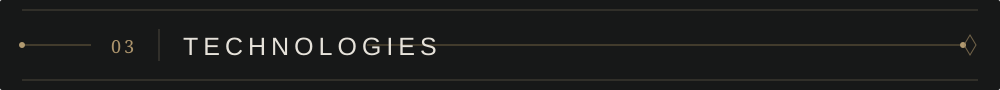
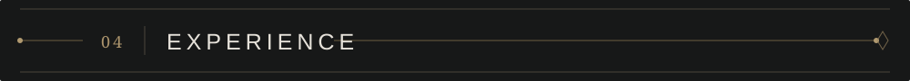
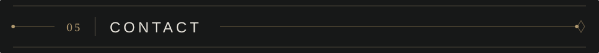

  

  <strong>Computer Science · Software Engineering · AI &amp; Cybersecurity</strong> 
  Designing useful systems, from sound engineering foundations to intelligent applications.

  <a href="https://github.com/enio0">GitHub</a> &nbsp;·&nbsp;
  <a href="https://www.linkedin.com/in/enio-peza-92479b259/">LinkedIn</a> &nbsp;·&nbsp;
  <a href="mailto:paenio5@gmail.com">Email</a>

 

<h2></h2>

I'm a **Computer Science student at Università della Svizzera italiana (USI)**, interested in building dependable software and applying AI to practical problems. I enjoy working across backend systems, web applications, and data-driven projects, with particular interests in **software engineering, machine learning, and cybersecurity**.

My work ranges from explainable fraud detection and LLM security evaluation to full-stack educational tools. Alongside university, I have gained hands-on experience in **digital forensics, network traffic analysis, and web development**.

Based between Lugano, Switzerland and Italy · BSc in Informatics, expected 2027

  

<h2></h2>

<table>
<tr><td width="50%" valign="top">

### FraudLens
**Machine Learning · Python · Random Forest · SHAP**

An end-to-end credit-card fraud detection pipeline built for highly imbalanced data. Evaluates models using precision, recall and AUPRC, and uses SHAP to explain individual predictions.

</td><td width="50%" valign="top">

### LLM Vulnerability Detection
**Cybersecurity · Python · LLM Evaluation**

An empirical study of whether large language models identify hidden vulnerabilities during ordinary code review without explicit security instructions. Evaluated eight LLMs across multiple vulnerability types and code lengths.

</td></tr>
<tr><td width="50%" valign="top">

### SEWorld
**Spring Boot · Vue.js · AI Integration**

An educational web platform with separate professor and student workflows, content management, AI-supported feedback, and GPT-based question-variant generation.

</td><td width="50%" valign="top">

### Fentus StockMarket
**Web Development · Financial Data · Search**

A stock-market discovery platform with a dataset of approximately 1,000 global companies, interactive filters, and a recommendation system.

</td></tr>
</table>

Project details reflect my CV. Add verified repository links beside each title when published.

 

<h2></h2>

| Focus | Technologies & methods |
|:--|:--|
| **Languages** | Python · Java · C · C++ · JavaScript · SQL |
| **Web & backend** | Spring Boot · Vue.js · React · Node.js · Flask |
| **AI & data** | Machine Learning · Random Forest · SHAP · LLM Evaluation |
| **Security** | Network Traffic Analysis · MITM Analysis · GDPR Compliance Testing |
| **Developer tools** | Git · GitHub · GitLab · SonarQube · VS Code · IntelliJ IDEA |

 

<h2></h2>

**IT & Forensic Analyst Intern** · DataLimits  
Switzerland · February 2026 – Present

- Perform digital forensic testing of web platforms, including network traffic, consent mechanisms and data flows in GDPR compliance assessments.
- Document technical findings for investigations and review.
- Contribute to website development and exploration of AI-based functionality.

**Web Maintainer** · BonApetit  
Italy · 2023 – 2024

- Maintained website content and supported reliable website performance.

 

<h2></h2>

Interested in software engineering, applied machine learning, or security-oriented projects? Feel free to get in touch.

**[GitHub](https://github.com/enio0)** · **[LinkedIn](https://www.linkedin.com/in/enio-peza-92479b259/)** · **[Email](mailto:paenio5@gmail.com)**

